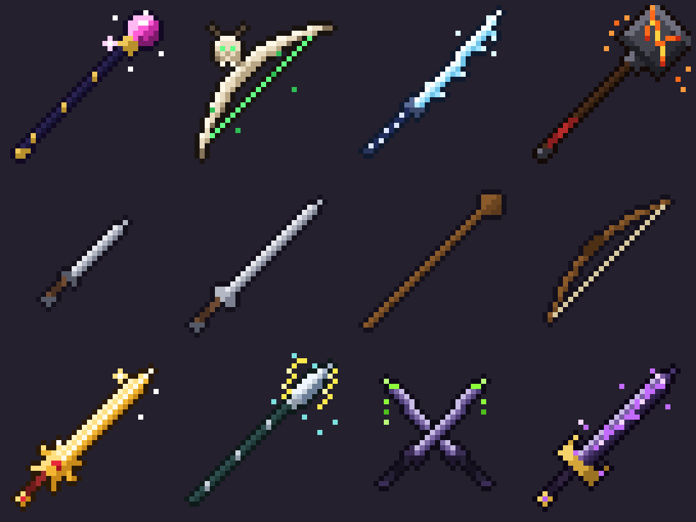

# Premium Weapon Set

Eight high-end 2D pixel-art weapons for the top shelf of the shop: they cost
30–60× what the starter gear costs and hit roughly 3× as hard, each with a
passive that changes how it plays. Four plain "common" weapons are included as
the baseline the premium tier is scaled against.

Preview every sprite with its stats: open `docs/index.html`.



## The weapons

| Weapon | Class | Tier | Cost | DPS (eff.) | Passive |
| --- | --- | --- | ---: | ---: | --- |
| Voidreaver | greatsword | legendary | 6,000 g | 37.0 | Void Rend: hits shred 15% armor for 4s, stacks ×3 |
| Frostbite | katana | legendary | 5,000 g | 49.4 | Frostbite: crits slow 40% for 2s |
| Inferno Maul | warhammer | legendary | 5,500 g | 38.9 | Eruption: slams leave a lava pool, 6 dmg/s for 3s |
| Astral Scepter | staff | legendary | 5,200 g | 32.3 | Arcane Echo: 25% chance to cast twice |
| Solaris Blade | sword | legendary | 4,500 g | 42.7 | Sunfire: 20% chance to ignite, 8 dmg/s for 3s |
| Dragonbone Bow | bow | epic | 4,800 g | 33.7 | Piercing Shot: arrows pass through 2 enemies |
| Stormcaller | spear | epic | 4,200 g | 33.5 | Chain Lightning: every 4th hit arcs to 2 enemies |
| Twin Fangs | dagger | epic | 3,800 g | 41.6 | Venom: stacking poison, 3 dmg/s ×5 |
| Iron Sword | sword | common | 100 g | 12.3 | — |
| Iron Dagger | dagger | common | 60 g | 12.7 | — |
| Short Bow | bow | common | 120 g | 8.3 | — |
| Oak Staff | staff | common | 150 g | 8.3 | — |

Full numbers (damage, attack speed, range, crit chance, crit multiplier,
knockback, flavor text) live in `data/weapons.json`.

### How the tiers scale

Costs and stats were set against the common gear so the trade-off is legible
to the player:

| Tier | Cost vs common | Effective DPS vs common | What you also get |
| --- | ---: | ---: | --- |
| Common | 1× | 1× | nothing extra |
| Epic | ~35× | ~2.8× | a utility passive (pierce, chain, poison) |
| Legendary | ~50× | ~3.4× | a passive that defines the weapon's playstyle |

Effective DPS is `damage × attack_speed × (1 + crit_chance × (crit_multiplier − 1))`.
The passives are on top of that, so the fast crit weapons (Frostbite, Twin
Fangs) sit high on raw numbers while the slow heavy ones (Inferno Maul,
Voidreaver) earn their price through knockback, armor shred, and area damage.
Tune `cost` and `stats` in `data/weapons.json`; the preview page re-derives
DPS and warns if the stored figures drift.

## Files

```
assets/weapons/
  <id>.png              32×32 sprite, transparent background (the in-game asset)
  spritesheet.png       all twelve on one strip, 32 px per frame
  spritesheet.json      atlas: id → {x, y, w, h}
  src/<id>.txt          the editable source: palette + 32 rows of glyphs
  preview/<id>@8x.png   8× nearest-neighbour blow-ups for review
  preview/contact-sheet.png
data/weapons.json       costs, stats, passives, flavor
docs/index.html         gallery with stats and a true-scale strip
tools/render_sprites.py text grids → PNGs, sheet, atlas, previews (stdlib only)
tools/build_preview.py  weapons.json + PNGs → docs/index.html
tools/draft_weapons.py  procedural first drafts of each grid (see below)
```

## Editing the art

The sprites are plain text. Each file in `assets/weapons/src/` is a palette
followed by a 32×32 grid of glyphs:

```
# Twin Fangs (epic)
o = #0f0c18
H = #c9bce6
P = #8dff3a
---
................................
..........o.....................
```

`.` is transparent. Change a pixel, then rebuild:

```
python3 tools/render_sprites.py      # regenerates every PNG, the sheet and the atlas
python3 tools/build_preview.py       # regenerates docs/index.html
```

Both scripts use only the Python standard library.

### Conventions used across the set

- 32×32, weapon drawn on the diagonal with the grip bottom-left and the
  business end top-right, so every sprite reads the same way in an inventory grid.
- Light comes from the top-left: the upper-left edge of every blade carries the
  highlight, the lower-right edge the shadow.
- One-pixel outline in a dark tint of the weapon's own hue (never pure black),
  applied only where a solid pixel meets transparency.
- Premium weapons get one glowing element each (a void seam, a sun fuller, an
  ice edge, lightning, magma, a green string, venom, a star orb) plus a few
  loose "motes" outside the outline that sell the enchantment. Commons get
  neither, which is what makes the premium shelf look premium.

### Roughing out a new weapon

`tools/draft_weapons.py` builds each grid procedurally in a rotated "weapon
space" (`u` along the blade, `v` across it) so diagonal geometry and shading
stay consistent. Add a builder function there, run
`python3 tools/draft_weapons.py --only <id>`, then hand-tune pixels in the
generated `.txt`. The script refuses to overwrite an existing grid unless you
pass `--overwrite`, so hand edits are safe.
